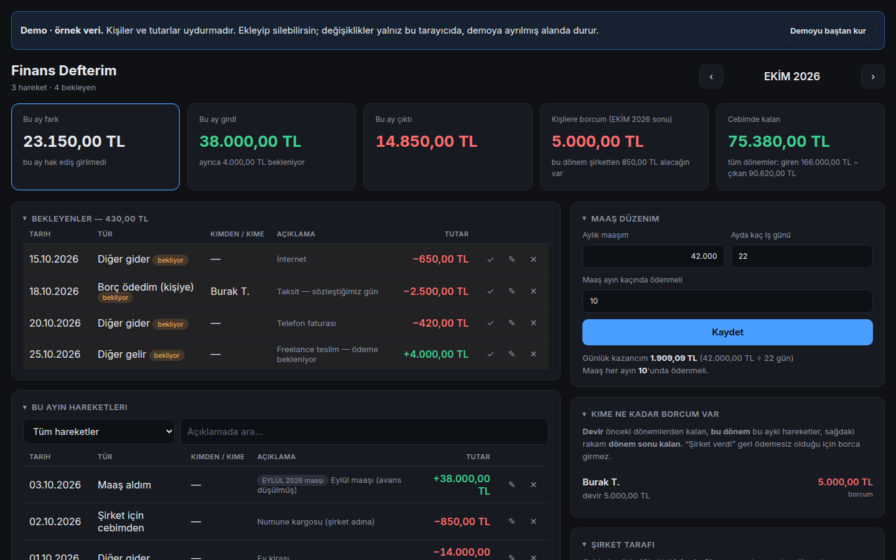

# Kişisel Finans Programı

> **EN —** A single-file personal finance ledger for people whose salary arrives in pieces, who borrow
> and lend informally, and who pay company expenses out of pocket. It keeps the three apart and shows
> the real net position, month by month. One HTML file — no install, no server, no dependencies;
> data never leaves the browser. Open `demo.html` to try it with sample data.

Maaşı parça parça gelen, arada elden borç alıp veren ve şirket adına cebinden ödeme yapan biri için
kişisel finans defteri. Bu üç akışı ayrı hesaplarda tutar ve her dönem için **gerçek net durumu** gösterir:
ne kadar maaş alacağın kaldı, kime ne kadar borcun var, şirketten ne alacaklısın, cepte ne kaldı.

Tek bir HTML dosyası: kurulum yok, sunucu yok, internet gerekmez; veriler hiçbir yere gönderilmez.



## Hemen dene

```bash
git clone https://github.com/emirdnz/kisisel-finans-programi.git
cd kisisel-finans-programi
```

| Ne açılır | Nasıl |
|---|---|
| **Demo** — uydurma verilerle dolu defter | `demo.html` dosyasına çift tıkla |
| **Boş defter** — kendi kayıtların için | `DEFTER.html` dosyasına çift tıkla |

Demo ayrı bir tarayıcı alanı kullanır; aynı tarayıcıda kendi defterin varsa ona dokunmaz.
Ekranın üstündeki **Demoyu baştan kur** düğmesi demoyu ilk hâline döndürür.

İsteğe bağlı — *Klasöre bağla* özelliği tarayıcıdan dosya izni istediği için yerel bir sunucuda çalışır:

```bash
python -m http.server 8000      # → http://localhost:8000/DEFTER.html
```

## Neler yapar

| Bölüm | Ne var |
|---|---|
| **Özet kutuları** | Kalan maaş · giren · çıkan · kişilere borç · cepte kalan; tıklayınca ayrıntısı açılır |
| **Bekleyenler** | Henüz olmamış ödemeler ve tahsilatlar; gerçekleşince ✓ ile gerçek kayda döner |
| **Dönemin hareketleri** | O ayın bütün kayıtları; tür, kişi ve metne göre süzülür, satır içinde düzenlenir |
| **Maaş takibi** | Ay ay hak ediş, ödenen ve kalan — "hangi ayın maaşını aldım" sorusunun cevabı |
| **Çalışma · mesai · izin** | Çalışılan gün, mesai saati, izin günü; hak edişi buradan tek tıkla hesaplar |
| **Maaş düzeni** | Aylık maaş, iş günü sayısı, ödeme günü; günlük kazanç hesabı |
| **Kişilere borç** | Kişi kişi: devir + bu dönem = dönem sonu kalan |
| **Şirket tarafı** | Cepten ödenenler, kişiden düşenler, şirketin geri ödemesiz verdikleri |
| **Düzenli hareketler** | Bir kez tanımla, her yeni dönemde bekleyen olarak gelsin |
| **Rapor ve yedek** | Açıklamalı metin rapor (panoya kopyalanır) · yedek indir / yedekten yükle |

Her bölüm başlığa tıklayınca kapanır; hangisinin kapalı olduğu hatırlanır.

### Hareket türleri

| Tür | Anlamı |
|---|---|
| Maaş hak edişi | O ay hak edilen maaş; para hareketi değil, alacak doğurur |
| Maaş aldım | İşverenden gelen para; yanında **hangi ayın maaşı** olduğu seçilir |
| Borç aldım / ödedim | Kişilerden alınan, kişilere verilen para |
| Ödemem geri döndü | Ödendi ama geri gönderildi → borç yeniden açılır |
| Borcu istemedi | Borç kapanır, kayıt durur |
| Mahsup | Maaş alacağının borca sayılması |
| Şirket verdi | Şirketin geri ödemesiz verdiği; borç değil |
| Şirket için cebimden | Kendi paranla şirket adına ödeme |
| Diğer gelir / gider | Geri kalan her şey |

## Tasarım kararları

- **Tarih değil, "hangi ayın maaşı".** Ödeme günü kayabiliyor; ayın başında gelen para bir önceki ayın
  maaşı olabilir. Maaş kaydında tarihten ayrı olarak dönem seçilir, maaş takibi ona göre toplar.
- **Tek akış, üç hesap.** Bütün kayıtlar tek bir hareket listesinde; her türün hesaba nasıl girdiği
  (giren, çıkan, alacak, mahsup, nötr) tür tablosunda tanımlı. "Gelecek ödemem" ile "bana gelecek para"
  aynı mekanizmayla — `planli` işaretiyle — çalışır.
- **Kişi borcu dönemsel.** Muhasebedeki gibi üç rakam: devir, bu dönem, dönem sonu kalan.
- **Düzenleme satır içinde.** Kayıt forma taşınmaz; *Kaydet*'e basılmadan hiçbir şey değişmez.
- **Kullanıcı geri bildirimiyle şekillendi.** Koddaki yorumlar her kararın hangi sorundan doğduğunu anlatır.

## Nasıl çalışır

- **Program:** `DEFTER.html` — HTML, CSS ve düz JavaScript; dış kütüphane, derleme adımı yok.
- **Veri:** Tarayıcının `localStorage`'ında. Program 7 günde bir yedek hatırlatır.
- **Yedek:** *Yedek indir* tarihli bir JSON dosyası verir (`finans-defterim-YYYY-AA-GG.json`);
  *Yedekten yükle* geri getirir.
- **Bilgisayarlar arası eşitleme (isteğe bağlı):** Bir klasöre bağlanınca (File System Access API) defter
  yedeği o klasöre yazar ve oradan okur; klasör Drive, OneDrive ya da bir git deposu olabilir.
  Chromium tabanlı masaüstü tarayıcılarda çalışır.

> **Not:** Kendi yedeklerini bu klasörde tutacaksan `.gitignore` yedek dosyalarını (`*.json`) zaten
> dışarıda bırakır — kişisel verin yanlışlıkla bir depoya gitmez.

## Dosyalar

```
DEFTER.html     programın kendisi
demo.html       demo defteri açar (DEFTER.html?demo=1)
index.html      sunucuda kök adresi deftere yönlendirir
docs/ekran/     README ekran görüntüsü (demo verisi)
```

## Lisans

[MIT](LICENSE)

---

Geliştirici: [Emir Engin Deniz](https://github.com/emirdnz)
